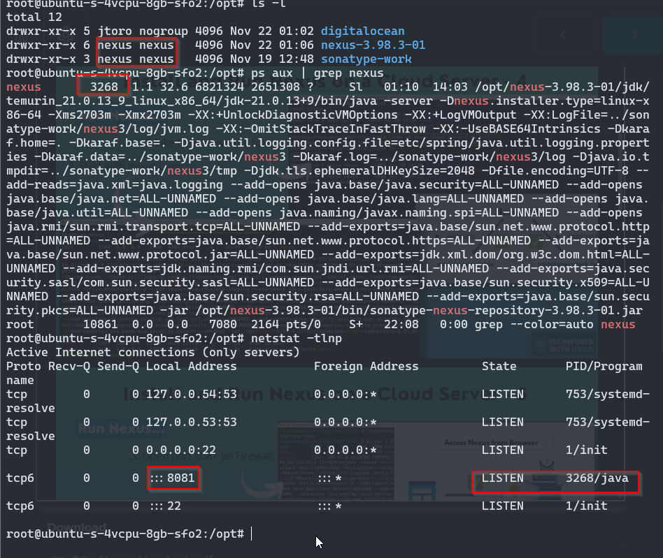
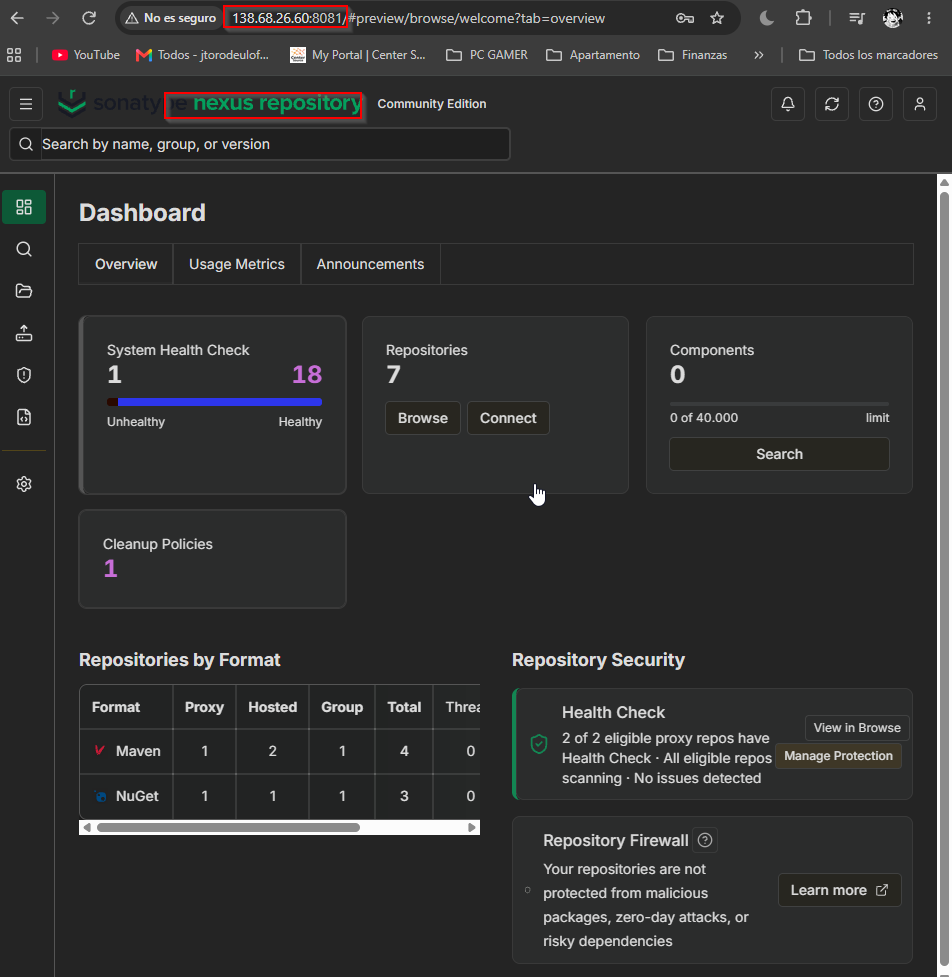
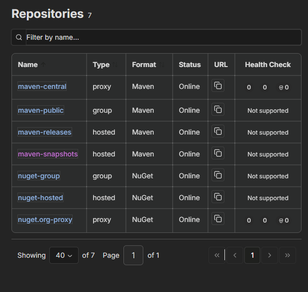
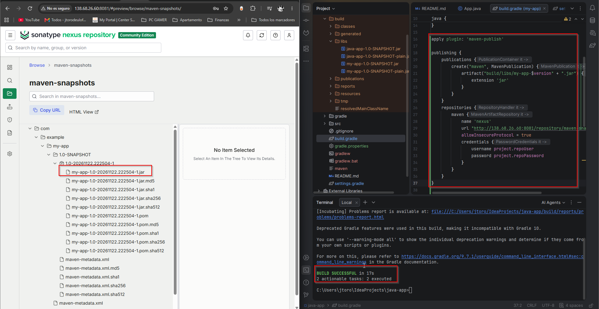
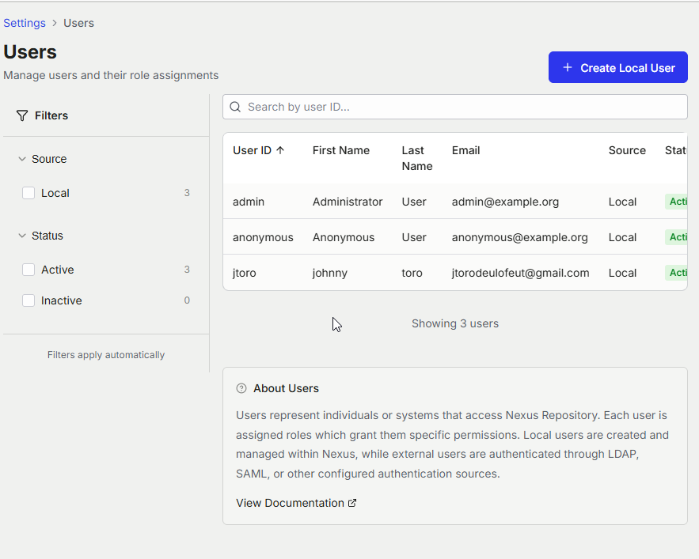
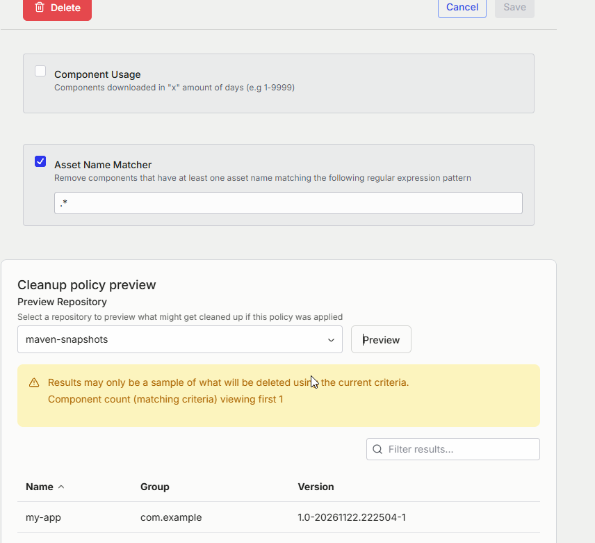

# Module-6-Johnny-Toro-Devops-Bootcamp.-
Module 6 of the techworld by nana bootcamp. 

For this module, I had to build and use nexus repository manager to store artifacts. 

After creating the droplet (Virtual machine) with the necessary resources, I installed nexus from the sonatype website, and created a new user and group to be able to run the service. 

As we can see on the image we have the nexus folder with the runtime of the app and the sonatype folder with the configuration files. 

The service is running on the port 8081 after enabling it in the firewall. 

I was able to access the UI of the nexus repository manager on my Browser. 

We can see the different default repositories and their types and formats. 

I was able to publish one of the gradle artifacts we had created in earlier lessons by adding the plugin to the configuration file with the address, authentication method and credentials. 

I created my own user and gave it the minimum permissions to publish. 

 

I was also able to see that I could create cleanup policies, like the one with the image that takes all the artifacts on the repo as was placed with the regular expression, this one would clear all artifacts, however, we need to compact the blob store if we want to free the space once its needed. 

\

